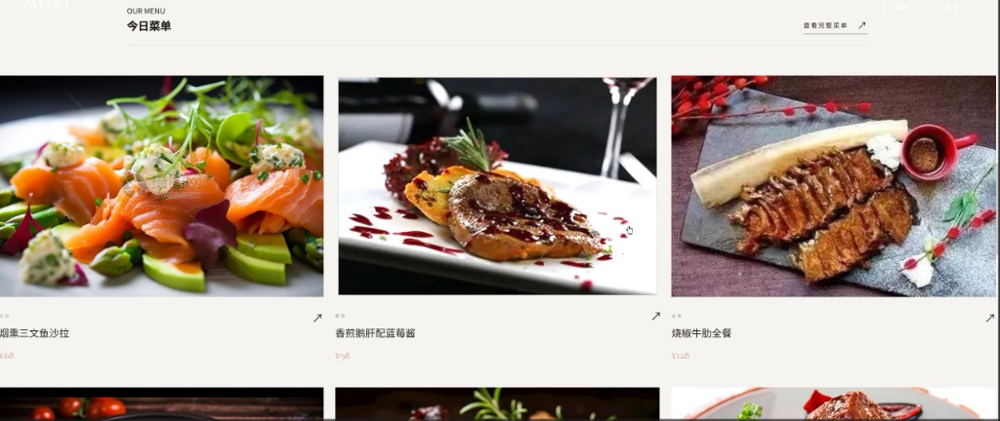
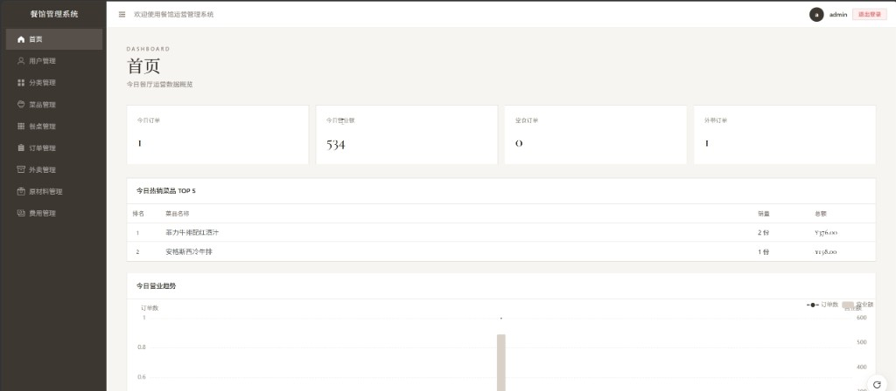

# 餐馆运营管理系统

顾客可以看官网、点餐、下单；店员可以在后台管用户、菜品、餐桌、订单、外卖、原材料和费用。

后端是 Spring Boot 3 + MySQL，前端是 Vue 3 + Element Plus + Vite。

## 页面

官网首页。


今日菜单。



后台首页。



## 本地运行

先准备 MySQL 8，建好库 `restaurant_db`。连接写在 `restaurant-management/src/main/resources/application.yml`，默认账号是 `root` / `123456`，端口 `3306`。库和表需要自己准备，仓库里没有建表脚本，也没有你的业务数据。

后端在 IDEA 里运行 `RestaurantManagementApplication`，工作目录选 `restaurant-management`。这样菜品图会从 `restaurant-management/upload` 读出来。接口地址是 `http://localhost:8080`。

```sh
cd restaurant-frontend
npm install
npm run dev
```

前端开发地址是 `http://localhost:5173`。

常用入口：

- `/` 官网
- `/menu` 菜单
- `/customer/login` 顾客登录
- `/login` 后台登录
- `/admin/dashboard` 后台首页

支付宝沙箱配置在本机的 `AlipayConfig.java`，这个文件没有提交。没有它，支付相关代码编译不过。
